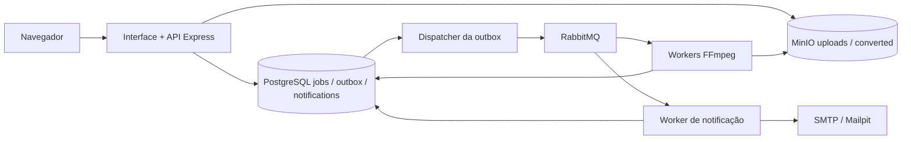
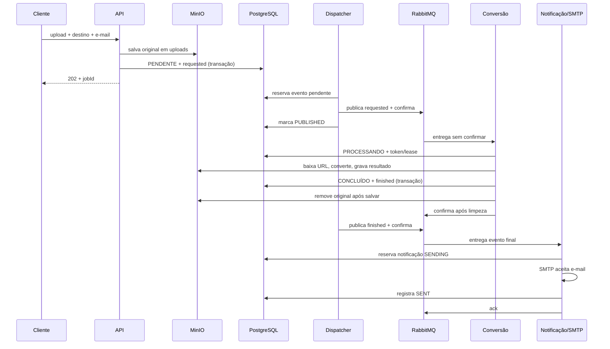

# Relatório técnico - Conversor de arquivos

IFPE | Sistemas Distribuídos | Áudio e vídeo

## 1. Como o sistema está organizado

O usuário envia um áudio ou vídeo pela página do sistema, escolhe o formato de saída e informa um e-mail. A API, que recebe esse pedido, salva o arquivo e devolve seu código de acompanhamento, chamado jobId. O envio do arquivo precisa terminar, mas a resposta não espera a conversão. Os formatos de saída são MP3 e WAV para áudio, e MP4 e WebM para vídeo.

A conversão fica com os workers: processos separados que retiram pedidos da fila e usam o programa FFmpeg para transformar os arquivos. Outro worker cuida do e-mail. Assim, uma demora no envio da notificação não bloqueia novas conversões.

**Figura 1.** O RabbitMQ distribui os pedidos. O MinIO guarda os arquivos, e o PostgreSQL registra a situação de cada pedido. Os workers são separados, mas usam o mesmo banco para coordenar o trabalho.

O Docker Compose inicia os serviços necessários. A página web é servida pela própria API, sem um container separado. A aplicação usa Node.js 22, e o FFmpeg já está instalado no container de conversão. As pastas de armazenamento, chamadas buckets uploads e converted, são criadas automaticamente quando não existem.

Para evitar que um pedido seja salvo no banco e perdido antes de chegar à fila, o sistema grava o pedido e seu evento juntos, em uma transação. A lista desses eventos é a outbox. Um processo chamado dispatcher verifica essa lista e envia as mensagens ao RabbitMQ. Se o envio for confirmado, mas essa confirmação não for registrada no banco, a mensagem pode ser enviada de novo. Por isso, os workers precisam saber lidar com repetições.

<!-- pagebreak -->

## 2. O caminho do arquivo

**Figura 2.** Passos de uma conversão bem-sucedida. O evento de conclusão pode ser enviado assim que o banco confirma o resultado, mesmo que a remoção do arquivo original ainda esteja em andamento. Notificação e SMTP aparecem juntos para facilitar a leitura, mas são serviços separados.

A mensagem leva o endereço do arquivo original no MinIO. O worker baixa esse arquivo, faz a conversão e salva o resultado como converted/<jobId>/result.<formato>. O endereço de download é um link assinado: permite acesso por um tempo limitado. O link da origem vale até sete dias, e o do resultado vale 24 horas. Consultar novamente um pedido concluído gera outro link de download.

Os links usados pelo navegador são configurados por MINIO_PUBLIC_*. Na demonstração local, o endereço é localhost. Para abrir o link em outro computador, é preciso configurar um endereço que esse computador consiga acessar.

O sistema confirma a conclusão no banco antes de apagar a origem. Se houver falha ao gerar o link ou concluir o pedido, o original é mantido. Se apenas a exclusão falhar, o pedido continua CONCLUÍDO, e o sistema tenta remover o arquivo novamente após 30 segundos, sem reconverter ou criar outro evento final. Uma falha definitiva antes da conclusão deixa o pedido em ERRO e mantém a origem para investigar o problema.

<!-- pagebreak -->

## 3. Mensagens e escolha do RabbitMQ

A rota POST /jobs recebe o arquivo, o formato de saída e o e-mail. Os campos são file, targetFormat e notifyEmail. A resposta HTTP 202 significa que o pedido foi aceito; ela inclui jobId e PENDENTE. A rota GET /jobs/:jobId permite acompanhar a situação e baixar o resultado.

Dados inválidos retornam 400; arquivo acima do limite retorna 413; código inválido retorna 400 e pedido não encontrado retorna 404. O tamanho máximo padrão é 104.857.600 bytes, ou 100 MiB.

### O que cada mensagem contém

As mensagens usam JSON, um formato de texto com nomes e valores. O contrato define os campos que precisam aparecer em cada mensagem:

| Evento / fila | Campos obrigatórios |
| --- | --- |
| conversion.requested / conversion.jobs | eventId, type, jobId, sourceUrl, sourceType, sourceFormat, targetFormat, notifyEmail, requestedAt, attempt. |
| conversion.finished / notification.jobs | eventId, type, jobId, notifyEmail, status, resultUrl, error, occurredAt. |

O pedido de conversão informa o arquivo, os formatos, o destinatário e a tentativa. O evento final informa o resultado: em CONCLUÍDO, resultUrl tem o link e error é nulo; em ERRO, resultUrl é nulo e error explica a falha. O sistema valida campos, códigos UUID, horários em formato ISO-8601, e-mail, formatos e links. O limite de tentativas é conferido no banco, não apenas no valor attempt da mensagem.

**Por que o arquivo não vai na fila:** o MinIO já armazena o conteúdo. Enviar apenas os dados do pedido e o link mantém as mensagens pequenas e evita repetir arquivos inteiros quando um pedido volta à fila. Em troca, o worker depende do armazenamento disponível e de um link ainda válido.

### Por que usar RabbitMQ em vez de Kafka

O RabbitMQ combina com uma fila de trabalhos: entrega um pedido a um worker disponível e permite confirmar quando ele foi tratado. O projeto usa confirmações, mensagens salvas e filas para novas tentativas e erros [1]. O Kafka também seria uma opção, especialmente para guardar um histórico de eventos e permitir que diferentes aplicações o leiam novamente [2].

Aqui, a necessidade principal é distribuir conversões entre workers, sem organizar um histórico para várias análises. O RabbitMQ atende a esse fluxo. Não foi feita uma comparação de velocidade entre os dois; a escolha está ligada ao modo de trabalho adotado.

**Situações registradas no banco:** pedidos: PENDENTE, PROCESSANDO, CONCLUÍDO e ERRO; outbox: PENDING, PUBLISHING e PUBLISHED; notificações: PENDING, SENDING, SENT e FAILED.

<!-- pagebreak -->

## 4. Como o sistema lida com falhas e repetições

### Confirmar uma mensagem

O worker não confirma a mensagem assim que a recebe: usa noAck=false. A confirmação manual, chamada ack, acontece depois de concluir sua parte. Na conversão, isso inclui limpar a origem; na notificação, registrar SENT. Para transferir uma mensagem a outra fila, primeiro o worker espera o RabbitMQ confirmar o novo envio.

Essa confirmação de envio se chama publisher confirm. Ela indica que o RabbitMQ recebeu a mensagem; o ack indica que o consumidor terminou sua responsabilidade [1]. Se houver queda antes do ack, a mensagem pode ser entregue novamente. É a garantia de entrega ao menos uma vez: repetições são possíveis. Ela não protege contra a perda definitiva dos dados do único broker usado no ambiente local.

### Evitar dois workers assumindo o mesmo pedido

O banco permite que apenas um worker faça a reserva de um pedido disponível. Ele recebe um token, que identifica sua permissão, e um lease, uma reserva válida por 120 segundos. A cada 30 segundos, o heartbeat renova essa reserva. Esses nomes descrevem o mecanismo usado para verificar se o worker ainda pode continuar.

Se perder a permissão ou deixar a reserva vencer, o worker encerra o FFmpeg e limpa seus arquivos temporários depois que o processo termina. Se um worker cair, outro poderá assumir após a reserva expirar. Quando a queda ocorre antes de salvar o resultado, pode ser necessário converter de novo.

### Novas tentativas e fila de erros

Cada conversão pode reservar até três tentativas, incluindo as interrompidas por queda. Uma falha comum devolve o pedido a PENDENTE. A espera é de 5 segundos após a primeira falha e 30 após a segunda. Na terceira, o pedido fica em ERRO e a mensagem vai para conversion.dlq. DLQ é a fila de erros, usada para guardar mensagens que precisam de análise. Não há quarta conversão. Mensagens fora do contrato vão direto para essa fila.

O e-mail também permite até três tentativas quando há certeza de que o servidor não aceitou o envio. Banco indisponível, pedido já ocupado e limpeza de um pedido concluído não contam como uma nova conversão. Essas esperas não têm um limite geral de repetições.

### Receber o mesmo pedido outra vez

Esse cuidado é chamado idempotência: repetir uma mensagem não deve criar outro resultado indevido. Se a reserva ainda estiver ativa, a nova entrega espera. Se o resultado já estiver salvo, o worker o aproveita. CONCLUÍDO retoma apenas a limpeza; SENT não envia outro e-mail. Isso reduz efeitos duplicados, mas não impede que uma conversão interrompida precise recomeçar.

### Quando não é possível confirmar o envio do e-mail

O servidor SMTP pode aceitar um e-mail e, logo depois, o banco falhar ao registrar SENT. Banco e SMTP não fazem essa operação juntos. Quando o resultado do envio é incerto, o sistema evita reenviar automaticamente: usa FAILED, guarda o motivo em last_error e encaminha à fila de erros. Se o banco também falhar nesse registro, a mensagem fica sem ack e sua recuperação não reenvia o e-mail.

Esse caso pode exigir revisão mesmo sem entrega comprovada. O Message-ID identifica a mensagem, mas não obriga o servidor externo a eliminar duplicatas. Antes de decidir por novo envio, é preciso conferir o Mailpit ou o servidor SMTP e o motivo registrado.

<!-- pagebreak -->

## 5. Resultados dos testes e limites

### Comparação com um e dois workers

Foram usados dois lotes de oito áudios WAV iguais, com 30 segundos, um canal e 48 kHz, convertidos para MP3. A medição vai do primeiro envio até o fim de todos os pedidos. Ela inclui envio, banco, fila, armazenamento e consultas de acompanhamento. Comando: node scripts/benchmark-workers.mjs.

| Workers | Tempo do lote | Arquivos por segundo |
| --- | ---: | ---: |
| 1 | 3,290 s | 2,432 |
| 2 | 1,969 s | 4,064 |

Com dois workers, a quantidade de arquivos concluídos por segundo aumentou cerca de 67,1%, e o tempo do lote caiu 40,2%. Cada lote teve oito pedidos e resultados diferentes, com uma tentativa por pedido. A fila mostrou um e dois consumidores nas respectivas rodadas. São resultados locais; não indicam a capacidade em produção. O sistema não registra qual container executou cada pedido. Fonte: output/validation/results.json.

### Funcionamento e recuperação após falhas

A etapa concluída registrou 60 testes aprovados no Windows e no Linux, a verificação de tipos do TypeScript aprovada e 21 cenários com os serviços integrados sem falhas. Foram conferidas as quatro conversões entre WAV/MP3 e MP4/WebM, downloads, e-mails, mensagens repetidas, reservas concorrentes, tentativas, filas de erros e recuperação. Os serviços eram reais; algumas falhas foram provocadas em pontos específicos do código para verificar o comportamento.

Ao interromper um container durante o FFmpeg, outro concluiu o mesmo pedido com duas tentativas e um e-mail. A falha ao gerar o link manteve a origem; a falha de limpeza retomou apenas a exclusão; a falha no banco após o aceite SMTP não duplicou o e-mail. Evidências: output/validation/correcoes-resultados.json e docs/validacao-integrada.md. A comparação de workers foi feita antes das últimas correções; os 21 cenários foram repetidos depois.

### O que ainda limita o sistema

O ambiente é local, com uma instância de banco, fila e armazenamento. A página é servida pela API e os processos usam o mesmo banco. Não há login, separação de acesso por usuário, exclusão automática de arquivos antigos ou monitoramento de capacidade. O tipo informado no upload não comprova o conteúdo do arquivo. A imagem MinIO usa latest, e a análise registrada encontrou quatro pacotes com alertas moderados. Não foram testados uma instalação com volumes vazios, e-mail externo ou uso em produção.

Para produção, seria preciso definir versões das imagens, revisar dependências, proteger conexões e credenciais, controlar acessos e limitar recursos de conversão. Também seria necessário definir retenção de arquivos, testar backups e recuperação, e acompanhar filas e erros. Para e-mails, uma opção seria avaliar um serviço que aceite uma chave para evitar envios repetidos e permita consultar a entrega. Essas são propostas de melhoria, não funções já implementadas.

### Referências

[1] RabbitMQ, Reliability Guide (4.3): https://www.rabbitmq.com/docs/reliability. [2] Apache Kafka, Introduction: https://kafka.apache.org/intro/. Código e evidências: commit ac69669, src/contracts/conversion-events.ts, src/outbox/dispatch.ts e handlers em src/workers/.
