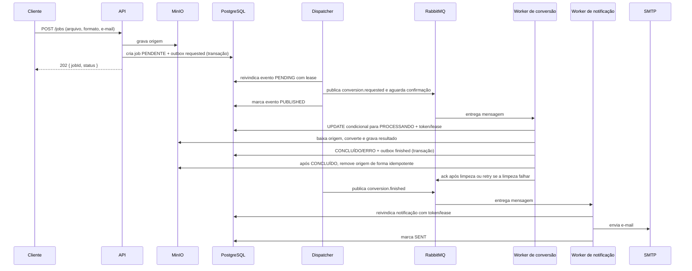

# Sequencia de processamento

## Falhas e reentregas

O worker de conversão usa `prefetch(1)`. A reivindicação bloqueia a linha disponível com `FOR UPDATE SKIP LOCKED` e faz o `UPDATE` na mesma instrução SQL: apenas um worker recebe o token válido. O lease dura 120 segundos e o heartbeat tenta renová-lo a cada 30 segundos. Se a posse é perdida, o sinal de cancelamento encerra o FFmpeg, o worker aguarda o fechamento do processo e a mensagem volta para retry de 30 segundos. Um prazo local impede que uma renovação sem resposta mantenha o processo ativo indefinidamente.

Falhas comuns de conversão liberam o job para `PENDENTE` e enviam a mensagem para retry de 5 segundos na primeira tentativa ou 30 segundos na segunda. Na terceira falha, o job recebe `ERRO`, um evento final e a mensagem vai para `conversion.dlq`. A notificação permite até três tentativas quando a falha comprova que o SMTP não aceitou a mensagem; no esgotamento, fica `FAILED` e vai para `notification.dlq`.

Cada nova reserva de conversão incrementa o contador, inclusive após uma queda do worker. Para notificação, apenas uma reserva `PENDING` incrementa o contador; recuperar `SENDING` expirado serve para registrar resultado incerto em `FAILED` e DLQ, sem enviar novamente. Quando as três tentativas já foram reservadas, a próxima recuperação obtém um token apenas para persistir o estado final e encaminhar à DLQ; não incrementa o contador nem inicia outra conversão ou envio. Se o processo cair entre persistir `ERRO`/`FAILED` e publicar na DLQ, a reentrega tenta novamente o encaminhamento.

Job ocupado e falha de acesso ao banco aguardam recuperação sem consumir tentativa de processamento. Essas esperas não têm teto global de reentregas. O limite é de três processamentos reservados, não de três entregas pelo RabbitMQ. Reservas feitas antes da alteração não são zeradas; registros antigos com contador acima do teto apenas finalizam na próxima recuperação elegível.

As filas de retry são duráveis e usam TTL com dead-letter de volta para a fila principal. Antes de reconhecer uma mensagem reenviada, o worker publica a nova mensagem com confirmação do RabbitMQ.

A conversão termina sua transação antes de excluir a origem. Uma falha de limpeza deixa `CONCLUÍDO` intacto e volta para retry de 30 segundos. A reentrega executa somente a limpeza; não incrementa a tentativa, não chama FFmpeg e não emite outro evento final.

O envio SMTP e a gravação de `SENT` são tratados separadamente. Se o SMTP aceitou e a gravação falha, ou se a aceitação é desconhecida, o worker registra `FAILED` com motivo para revisão e encaminha à DLQ. Se também não conseguir gravar essa condição, não reconhece a mensagem; a recuperação de `SENDING` expirado impede novo envio. Essa escolha evita reenvio automático nas janelas ambíguas, mas pode interromper uma notificação ainda não entregue. Consulte [contratos e diagnóstico](contratos.md).
